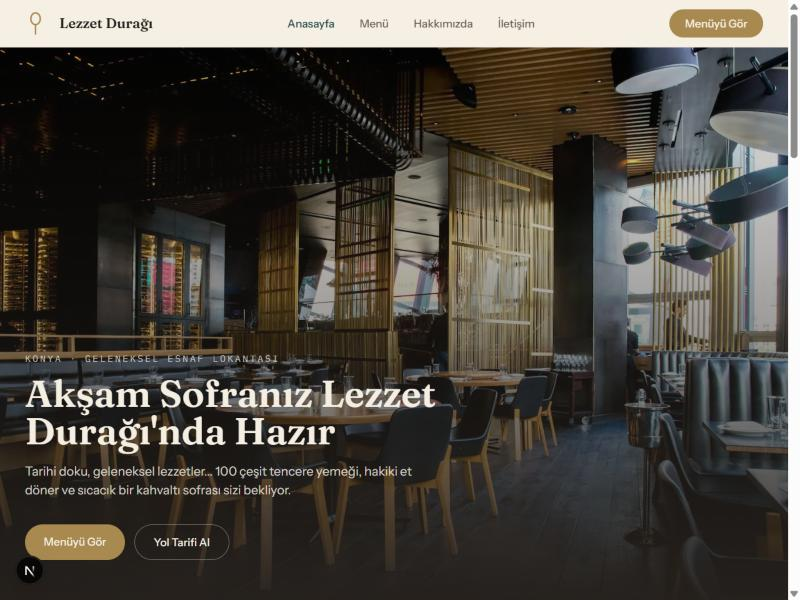
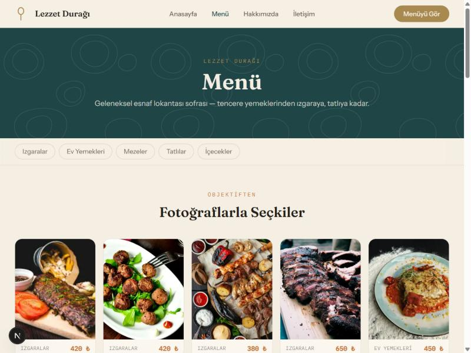

<a id="turkce"></a>

# Lokantalar için Hızlı — Web Sitesi

🇹🇷 Türkçe (bu sayfa) · [🇬🇧 English](#english)

**İşletmeleri için hızlı web sitesi şablonu.** Lokanta, kafe, pastane, kahvaltıcı, fast-food — hepsi için uyarlanabilir: menü ve görseller bir Google Sheets dosyasından yönetilir, kod veya admin panel gerektirmez.



> Yukarıdaki görsellerde kullanılan fotoğraflar sadece tanıtım amaçlıdır
> (Unsplash, telifsiz). Şablon kendisi fotoğrafsız gelir — hiçbir görsel
> girilmeden önce markaya uygun, nötr bir placeholder gösterir; kırık
> görsel ikonu asla çıkmaz.


## Neden bu şablon?

- 🍽️ **Sadece restorana özel değil** — menü + fiyat + kategori mantığı
  her yeme-içme işletmesine uyar: lokanta, kafe, pastane, kahvaltıcı,
  fast-food...
- 📋 **Menü yönetimi kod bilmeden** — işletme sahibi menüyü bir Google
  Sheet üzerinden günceller, site en geç 5 dakikada kendiliğinden
  yenilenir (ISR).
- 🚫 **Admin panel / veritabanı yok** — tamamen sunucusuz, Vercel, Netlify
  gibi hosting'lerin ücretsiz planında çalışır, bakım derdi yok.
- 🖼️ **Görseller de Sheet'ten yönetilir** — logo, hero, kategori
  görselleri kodda gömülü değil.
- 📱 **Mobil öncelikli, hızlı** — statik sayfalar + ISR, gereksiz kütüphane
  yok.
- 🇹🇷 **Türkçe içerik** — kullanıcıya görünen her şey Türkçe.

## Ekran görüntüleri



## Teknoloji

Next.js (App Router) · TypeScript · Tailwind CSS · Google Sheets (CSV export)

## Geliştirme

```bash
npm install
npm run dev
```

[http://localhost:3000](http://localhost:3000)

## Ortam değişkenleri

`.env.local.example` dosyasını `.env.local` olarak kopyalayıp doldurun:

- `GOOGLE_SHEET_ID`, `MENU_SHEET_GID`, `IMAGES_SHEET_GID` — Google Sheets entegrasyonu. Boş bırakılırsa site `data/menu-seed.csv` içindeki örnek menüyü kullanır ve görseller için markaya uygun bir placeholder gösterir — hiçbir zaman boş kalmaz.
- `NEXT_PUBLIC_SITE_URL` — canlı alan adı (Open Graph/Twitter kartlarının doğru görsel/URL üretmesi için).

Menü veya görsel güncellemesi için işletmenin kod veya yeniden deploy ile
uğraşması gerekmez: ilgili Google Sheet hücresini güncellemesi yeterli,
site en geç 5 dakika içinde otomatik yenilenir (ISR `revalidate: 300`).

## Deploy

Standart bir Next.js projesi olduğu için [Vercel](https://vercel.com),
[Netlify](https://netlify.com) veya [Cloudflare Pages](https://pages.cloudflare.com)
gibi hemen hemen her modern hosting'e ek yapılandırma gerektirmeden,
birkaç dakikada deploy edilebilir:

1. Depoyu GitHub üzerinden seçtiğiniz platforma bağlayın.
2. Yukarıdaki ortam değişkenlerini platformun proje ayarlarından girin.
3. Deploy edin.

## Kendi işletmen için uyarlama

- `lib/contact.ts` — adres, saat, sosyal medya linkleri
- `components/Header.tsx`, `Footer.tsx`, `app/layout.tsx` — marka adı
- `components/BrandMark.tsx` — logo (gerçek logo ile değiştirin)
- Google Sheet — gerçek menü ve görseller

## Lisans

[MIT](./LICENSE)

---

<a id="english"></a>

# Quick Website for Restaurants

🇬🇧 English · [🇹🇷 Türkçe](#turkce)

**A quick website template for food & beverage businesses.** Restaurants,
cafés, bakeries, breakfast spots, fast-food — it adapts to all of them:
menu and images are managed from a Google Sheet, no code or admin panel
knowledge required.


> The photos shown above are for demo purposes only (Unsplash,
> royalty-free). The template itself ships without any photos — until an
> image is filled in, it shows a neutral, on-brand placeholder instead of
> a broken-image icon.

🔗 **Live demo:** _(add the link here after deploying)_

## Why this template?

- 🍽️ **Not just for restaurants** — the menu + price + category logic
  fits any food & beverage business: restaurant, café, bakery, breakfast
  spot, fast-food...
- 📋 **No-code menu management** — the owner updates the menu from a
  Google Sheet, the site refreshes itself within 5 minutes (ISR).
- 🚫 **No admin panel / database** — fully serverless, runs on the free
  tier of hosts like Vercel or Netlify, nothing to maintain.
- 🖼️ **Images are managed from the Sheet too** — logo, hero, and category
  images aren't hardcoded; empty slots show an on-brand placeholder
  instead of a broken image.
- 📱 **Mobile-first, fast** — static pages + ISR, no unnecessary
  dependencies.
- 🇹🇷 **Turkish content, English code** — everything user-facing ships in
  Turkish by default; adapt the copy for your own language.

## Screenshots


## Tech stack

Next.js (App Router) · TypeScript · Tailwind CSS · Google Sheets (CSV export)

## Development

```bash
npm install
npm run dev
```

[http://localhost:3000](http://localhost:3000)

## Environment variables

Copy `.env.local.example` to `.env.local` and fill it in:

- `GOOGLE_SHEET_ID`, `MENU_SHEET_GID`, `IMAGES_SHEET_GID` — Google Sheets integration. If left empty, the site uses the sample menu in `data/menu-seed.csv` and shows an on-brand placeholder for images — it never ships empty.
- `NEXT_PUBLIC_SITE_URL` — the live domain (so Open Graph/Twitter cards generate the right image/URL).

Updating the menu or images never requires touching code or redeploying:
updating the relevant Google Sheet cell is enough, the site refreshes
itself within 5 minutes (ISR `revalidate: 300`).

## Deploy

Since it's a standard Next.js project, it can be deployed in minutes to
almost any modern host without extra configuration — [Vercel](https://vercel.com),
[Netlify](https://netlify.com), [Cloudflare Pages](https://pages.cloudflare.com),
and more all work out of the box:

1. Connect the repo to your platform of choice via GitHub.
2. Fill in the environment variables above in that platform's project settings.
3. Deploy.

## Adapting it for your own business

- `lib/contact.ts` — address, hours, social links
- `components/Header.tsx`, `Footer.tsx`, `app/layout.tsx` — brand name
- `components/BrandMark.tsx` — logo (replace with your real logo)
- Google Sheet — your real menu and images

## License

[MIT](./LICENSE)
